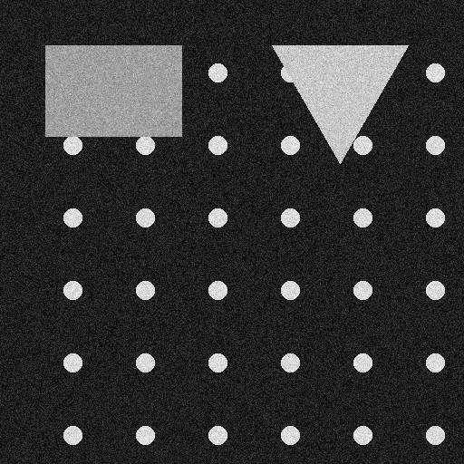
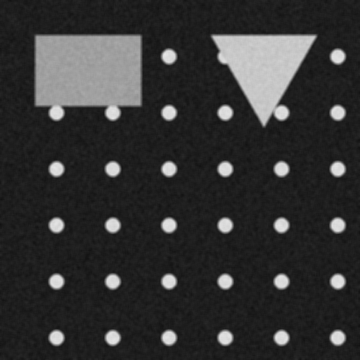
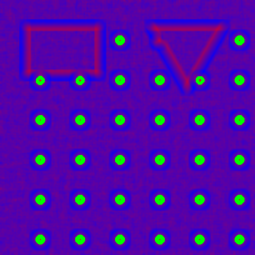

# Primjena konvolucije i korelacije na slikama
## Druga laboratorijska vježba — PPKS

**Autor:** Juraj Ajčić  
**Datum:** 22. ožujka 2026.

---

## 1. Uvod

U ovoj vježbi obrađujemo dvije temeljne operacije u obradi slike:

| Operacija | Primjena |
|---|---|
| **Konvolucija** | Filtriranje slike (zamućivanje, izoštravanje, detekcija rubova) |
| **Korelacija** | Traženje uzorka (template matching) u slici |

---

## 2. Ulazna slika

Sintetička slika (512 × 512 px) generirana za ovu vježbu sadrži:
- tamnu pozadinu,
- mrežu jednakih bijelih kružnica (koje ćemo tražiti korelacijom),
- pravokutnik i trokut (geometrijske forme),
- Gaussov šum (simulacija realne slike).



---

## 3. Konvolucija — Gaussov filtar

### 3.1 Teorija

Konvolucija je matematička operacija koja svaki piksel u izlaznoj slici izračunava kao vaganu sumu piksela iz okoline ulazne slike:

$$O[x, y] = \sum_m \sum_n I[x - m,\; y - n] \cdot K[m, n]$$

gdje je **K** konvolucijska jezgra (kernel). Ključna razlika u odnosu na korelaciju je **zrcaljenje jezgre** (u oba smjera).

### 3.2 Gaussov filtar

Gaussov filtar je najrašireniji filtar za zamućivanje (blur). Njegova jezgra slijedi Gaussovu (normalnu) distribuciju:

$$g(x, y) = \frac{1}{2\pi\sigma^2} \; e^{-\frac{x^2 + y^2}{2\sigma^2}}$$

Veći **σ** znači jače zamućivanje. Gaussov filtar je simetričan pa za njega vrijedi:  
*konvolucija ≡ korelacija.*

#### Implementacija jezgre (prema PPKS_03_konvolucija.pdf)

```python
import numpy as np
import scipy.stats

def gaussian_kernel(size: int, sigma: float = 1.0) -> np.ndarray:
    x = np.linspace(-sigma, sigma, size + 1)
    kernel1d = np.diff(scipy.stats.norm.cdf(x))
    kernel2d = np.outer(kernel1d, kernel1d)
    kernel2d /= kernel2d.sum()   # normalizacija → zbroj = 1
    return kernel2d
```

#### Gaussova jezgra (5 × 5, σ = 1.0)

|  | 0 | 1 | 2 | 3 | 4 |
|--|---|---|---|---|---|
|**0**| 0.0287 | 0.0363 | 0.0393 | 0.0363 | 0.0287 |
|**1**| 0.0363 | 0.0460 | 0.0498 | 0.0460 | 0.0363 |
|**2**| 0.0393 | 0.0498 | **0.0539** | 0.0498 | 0.0393 |
|**3**| 0.0363 | 0.0460 | 0.0498 | 0.0460 | 0.0363 |
|**4**| 0.0287 | 0.0363 | 0.0393 | 0.0363 | 0.0287 |

Središnji piksel ima najveću težinu → sačuvan je oblik rubova bolje nego kod mean filtra.

#### Primjena

```python
import scipy.ndimage

blurred = scipy.ndimage.convolve(image_arr, gaussian_kernel(5, sigma=1.0), mode='reflect')
```

`mode='reflect'` rješava rub slike zrcaljenjem piksela.

### 3.3 Rezultat Gaussovog filtriranja


Šum je uspješno reduciran, a obrisi oblika su još uvijek vidljivi.

---

## 4. Konvolucija — Mean (Box) filtar

### 4.1 Opis

Mean (kutijasti) filtar zamjenjuje svaki piksel aritmetičkom sredinom piksela u prozoru:

$$K_{mean}[i,j] = \frac{1}{n^2}, \quad n^2 = \text{broj piksela u jezgri}$$

Za 5 × 5 jezgru: svi elementi = **0.04**

#### Mean jezgra (5 × 5)

$$K = \frac{1}{25} \begin{pmatrix} 1 & 1 & 1 & 1 & 1 \\ 1 & 1 & 1 & 1 & 1 \\ 1 & 1 & 1 & 1 & 1 \\ 1 & 1 & 1 & 1 & 1 \\ 1 & 1 & 1 & 1 & 1 \end{pmatrix}$$

### 4.2 Rezultat Mean filtriranja



Mean filtar uzrokuje jače i ujednačenije zamućivanje od Gaussovog, ali dolazi do "box blura" (vidljivih kvadratnih artefakata na rubovima).

### 4.3 Usporedba filtera

| Svojstvo | Mean filtar | Gaussov filtar |
|---|---|---|
| Težine | Sve jednake (1/n²) | Smanjuju se od centra |
| Čuvanje rubova | Slabije | Bolje |
| Redukcija šuma | Dobra | Izvrsna |
| Artefakti | "Box blur" | Nema |
| Računalna složenost | Niža | Malo viša |

---

## 5. Korelacija — traženje uzorka (template matching)

### 5.1 Teorija

Korelacija je operacija slična konvoluciji, ali bez zrcaljenja jezgre:

$$O[x, y] = \sum_m \sum_n I[x + m,\; y + n] \cdot K[m, n]$$

Koristi se za **traženje uzorka** (template matching): ulazna **jezgra K je uzorak** koji tražimo unutar slike.

Za robusno detektiranje neovisno o osvjetljenju koristi se **normalizirana unakrsna korelacija (NCC)**:

$$\text{NCC}(x,y) = \frac{\sum (I_{patch} - \mu_I)(T - \mu_T)}{\sigma_I \cdot \sigma_T \cdot n}$$

Vrijednost NCC je u rasponu \[−1, 1\]:
- **+1** → savršeno podudaranje
- **0** → nema korelacije
- **−1** → inverzno podudaranje

### 5.2 Traženi uzorak (template)

Tražimo **kružnicu** (bijela, promjer ≈ 20 px) koja se ponavlja u ulaznoj slici:


### 5.3 Implementacija NCC

```python
def normalized_cross_correlation(image, template):
    h, w = template.shape
    t_mean = template.mean()
    t_norm = (template - t_mean) / (template.std() + 1e-8)

    ncc = np.zeros_like(image, dtype=np.float32)
    for r in range(image.shape[0]):
        for c in range(image.shape[1]):
            patch = image[r:r+h, c:c+w]
            p_norm = (patch - patch.mean()) / (patch.std() + 1e-8)
            ncc[r, c] = (p_norm * t_norm).mean()
    return ncc
```

### 5.4 Rezultat korelacije

Toplinskom kartom (heatmap) prikazana su mjesta visoke korelacije — svako zeleno obilježje označava pronađenu kružnicu u ulaznoj slici.



**Pronađena podudaranja (NCC > 0.75):** 1431 piksela iznad praga,  
što odgovara svim kružnicama u rešetkastom rasporedu.  
Crvena = visoka korelacija (uzorak prisutan), plava = niska korelacija.

---

## 6. Kada koristiti konvoluciju, a kada korelaciju?

**Konvolucija** se koristi kada radimo s filtrima čija je jezgra simetrična (Mean, Gaussian) ili kada nas zanima filtriranje kao takvo (izoštravanje, detekcija rubova, zamućivanje). Matematički, konvolucija zrcali jezgru pa se rezultat razlikuje od korelacije samo kod asimetričnih jezgri.

**Korelacija** se koristi kada želimo pronaći gdje se neki uzorak (template) pojavljuje u slici. Budući da je template "fizički" uzorak koji klizimo po slici, ne želimo ga zrcaliti — stoga koristimo korelaciju, ne konvoluciju.

> **Pravilo palca:** Za *filtriranje* → konvolucija. Za *prepoznavanje uzoraka / traženje* → korelacija.

---

## 7. Zaključak

U ovoj vježbi implementirana su i demonstrirana:

1. **Gaussov filtar** (konvolucija, 5×5, σ=1.0) — učinkovito uklanjanje Gaussovog šuma uz dobro čuvanje rubova.  
2. **Mean (box) filtar** (konvolucija, 5×5) — jednostavno zamućivanje, lošije čuvanje rubova.  
3. **Normalizirana unakrsna korelacija (NCC)** — robustno traženje uzorka neovisno o osvjetljenju.

Svi kerneli preuzeti su iz predavanja PPKS_03_konvolucija.pdf, implementacija je u Python 3 korištenjem `numpy`, `scipy` i `Pillow`.
